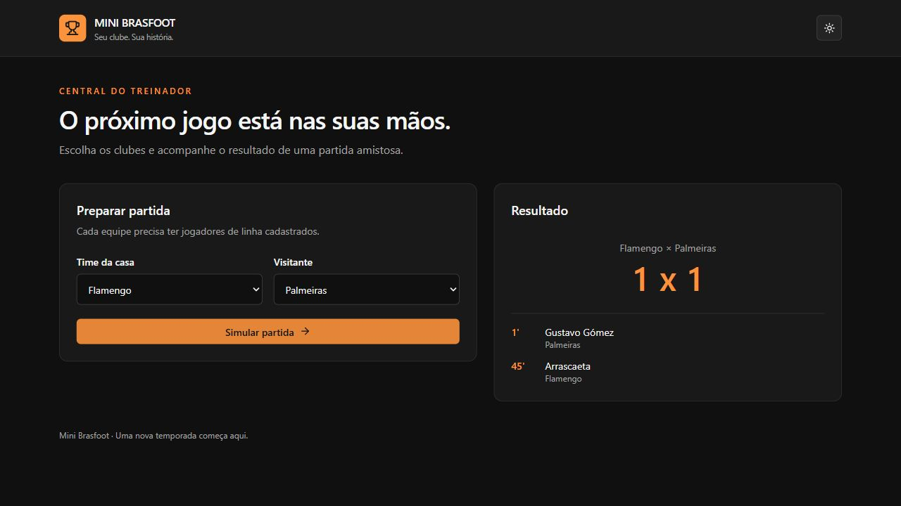
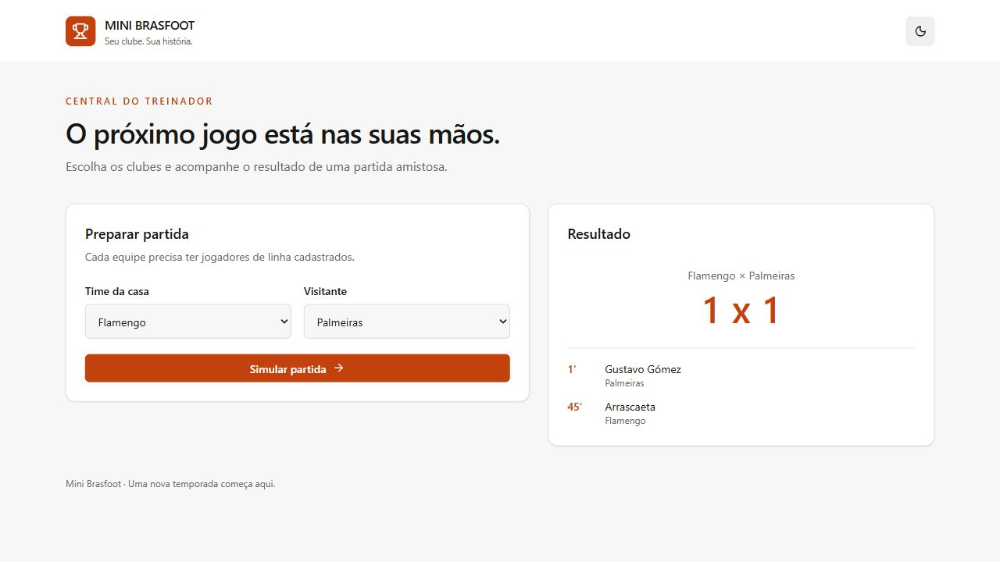
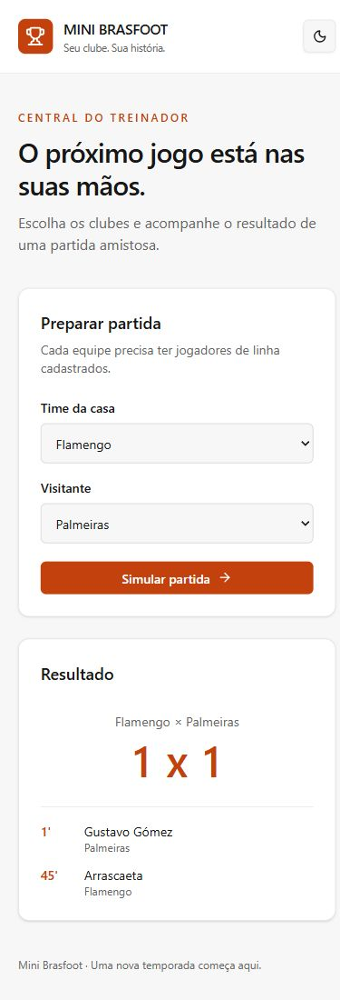

# Validação — fase 1, 12/10/2026 (America/Cuiaba)

## Resultados executados

| Verificação | Resultado |
| --- | --- |
| Build da solução .NET | Sucesso, zero erros e zero avisos com `-m:1 /nr:false` |
| Testes xUnit | 15 aprovados, zero falhas/ignorados |
| Build React/TypeScript/Vite | Sucesso, rotas divididas em chunks sem aviso de tamanho |
| ESLint | Sucesso |
| Dependências npm | Instaladas com lockfile; auditoria final da instalação: zero vulnerabilidades |
| NuGet, incluindo transitivas | Nenhum pacote vulnerável reportado |
| Modelo EF vs migrations | `has-pending-model-changes`: nenhuma diferença |
| Script incremental MySQL | Gerado/revisado: apenas índice e FK, sem drops de tabelas/dados |
| MySQL real, somente leitura | MySQL 8.0.45, brasfootdb, 6 times, 11 jogadores, zero órfãos |
| Histórico de migrations real | InitialMySql aplicada; FK nova ainda não aplicada |
| HTTP real | GET /health, /teams, /teams/{id}/players e Swagger funcionando |
| Simulação real via HTTP | 200, empate 0 x 0 válido e contagem de gols consistente |
| Navegador + API + MySQL | Carregou os seis clubes; Flamengo x Palmeiras 1 x 1 com artilheiros/minutos |
| Validações no navegador | Mesmo clube bloqueado pelo formulário; time sem jogadores de linha mostra erro da API |
| Aparência/responsividade | Tema escuro/claro e viewport de 390px inspecionados |

## Cobertura dos testes

Simulação: fronteiras 10/11/30/31 e diferença negativa, média truncada incluindo GK, 500 seeds verificando limites/autores/minutos/ordem/consistência, empate 0x0, zebra com empate, rejeição de mesmo clube e elenco vazio/somente GK.

HTTP com fake: criação/consulta/exclusão de times, cadastro/consulta/listagem/atualização/exclusão de jogador, aliases legados, preservação de TeamId ao atualizar, validações de criação/atualização, bloqueio de exclusão com jogadores, times inválidos/iguais, ProblemDetails, CORS, health e Swagger.

Os testes HTTP usam fake; não afirmam validar escrita no MySQL real. As verificações reais desta execução fizeram consultas e simulações sem persistência. Não foram inseridos/excluídos registros do banco existente para testar CRUD.

## Evidências visuais







## Limitações e decisões

- Nenhuma migration foi aplicada. Backup e revisão continuam necessários antes de executar update no banco existente.
- Docker não estava disponível; Dockerfile/Compose foram preparados, mas não executados.
- Histórico ainda não é persistido, como no projeto original; não houve criação de módulos futuros.
- Sem testes de carga, autenticação ou deploy nesta fase.
- A CLI shadcn trouxe a vulnerabilidade de desenvolvimento braces/fast-glob sem correção compatível. Componentes oficiais foram gerados, imports ajustados e CLI/dependências redundantes removidos; a instalação final reportou zero vulnerabilidades.
- No sandbox, VSTest não conectou ao testhost e conexões locais/algumas consultas de registros falharam. Os testes, consultas MySQL/HTTP e servidores locais foram verificados fora dele após autorização da ferramenta. Não se concluiu que o servidor MySQL estivesse ausente com base na primeira sondagem.
- O Git inicialmente mostrava o código como não rastreado; nenhum commit ou push foi realizado.

## Repetir

```powershell
dotnet build BrasfootAPI.sln -m:1 /nr:false
dotnet test backend/MiniBrasfoot.Tests/MiniBrasfoot.Tests.csproj --no-build -m:1 /nr:false
dotnet ef migrations has-pending-model-changes --project backend/MiniBrasfoot.Infrastructure --startup-project backend/MiniBrasfoot.Api --no-build
dotnet run --project tools/DatabaseProbe
npm --prefix frontend run lint
npm --prefix frontend run build
```
