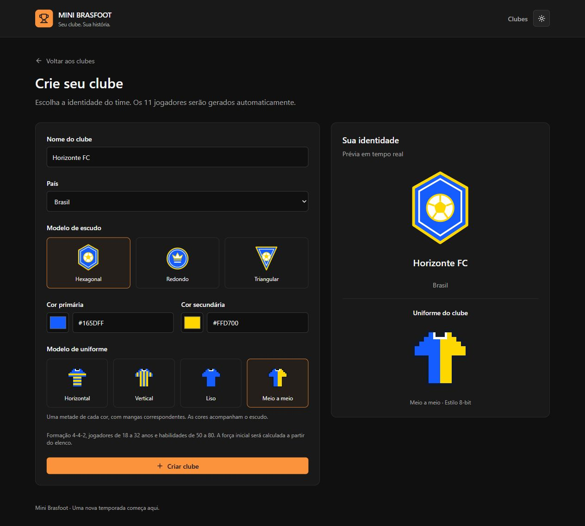
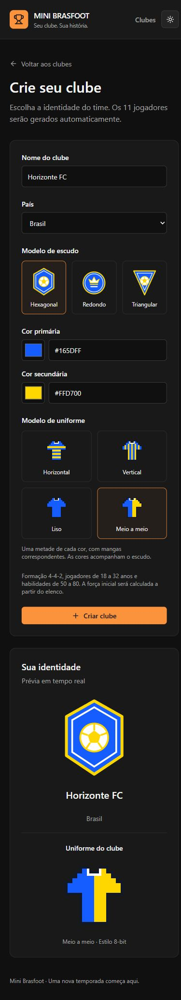
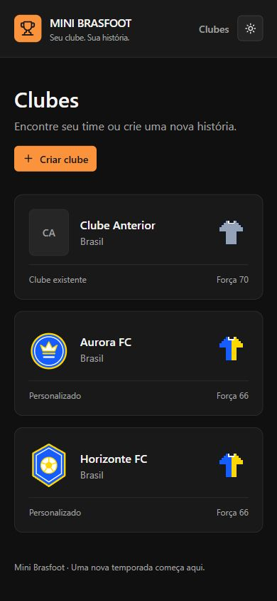
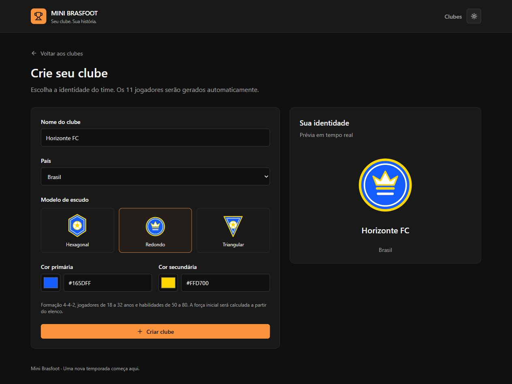
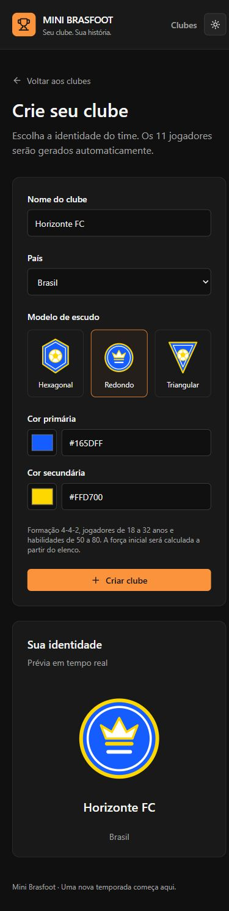
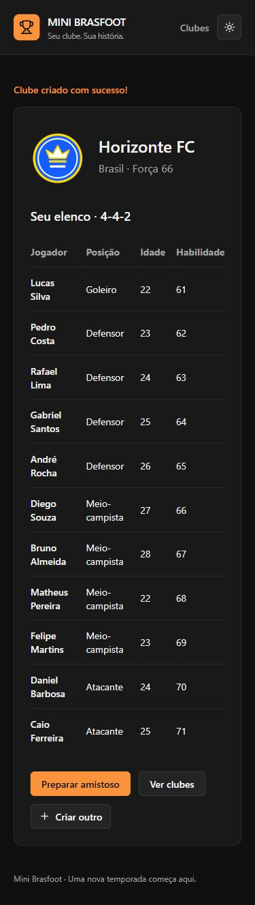

# Validação — fase 1, 12/10/2026 (America/Cuiaba)

## Uniformes e planejamento de competições - 14/10/2026

- Planejamento e decisões do usuário salvos em PLANEJAMENTO-COMPETICOES.md. Não foi implementada rotina, botão, endpoint ou tabela de competição.
- Quatro SVGs 8-bit novos em src/assets/kits, sem alterar os três escudos fornecidos. Imports React via SVGR existente, sem novas dependências.
- Build .NET: zero erros/avisos. xUnit: **69 testes aprovados**, sem falhas/ignorados.
- Build React/TypeScript/Vite e ESLint aprovados. Vitest: **26 testes aprovados**, incluindo os testes anteriores de preservação dos escudos.
- Novos testes verificam quatro modelos, rejeição de inválido/null, compatibilidade de JSON anterior sem uniforme (liso), retorno em criação/GET/lista, preservação pelo PUT anterior e persistência de identificador com clube antigo intacto em SQLite isolado em memória.
- Frontend: SVG inline, geometria ortogonal/crispEdges sem filtros/gradientes/IDs compartilhados, independência de cores, liso sem secundária no desenho, fallback de modelo desconhecido/cores inválidas, seleção acessível e validação de formulário.
- Migration AdicionarModeloDeUniforme e snapshot consistentes: has-pending-model-changes sem diferenças. SQL gerado/revisado acrescenta somente Teams.ModeloDoUniforme varchar(32) NULL e registra o histórico. Não aplicado ao MySQL; nenhum dado real alterado.
- QA visual com Vite na porta 5174 e API simulada em memória na 5064. Não usa MySQL. Verificados seleção, prévia, liso inalterado ao trocar secundária, falha preservando seleção, retry com sucesso, 11 jogadores e cards com uniforme. A 390px, documento de 375px sem overflow horizontal, inclusive no sucesso do cadastro.
- Estilos computados da camisa meio a meio: contorno rgb(17,24,39), primária rgb(22,93,255), secundária rgb(255,215,0), gola branca. No liso, somente contorno, primária e gola mesmo após trocar secundária para verde.
- Não foi realizada nova validação do histórico/schema/credenciais do MySQL. Banco oficial continua MySQL/Pomelo; SQLite apenas nos testes. A API nova requer a coluna antes de consultar clubes no banco existente.







---

## Etapa 2 — 13/10/2026 (America/Cuiaba)

| Verificação executada | Resultado |
| --- | --- |
| Build .NET | Sucesso, zero erros e avisos |
| xUnit | 58 aprovados, zero falhas/ignorados |
| Build React/TypeScript/Vite e ESLint | Sucesso |
| Vitest | 16 aprovados em dois arquivos |
| SVGs fornecidos | Hashes preservados; testes com os desenhos reais comparando atributos/elementos |
| EF modelo vs snapshot | Nenhuma diferença após AddCustomTeamBadges |
| Migration/SQL Up | Quatro ADD COLUMN e histórico, sem remoção/alteração de dados existentes; não aplicada |
| Auditoria npm da instalação final | Zero vulnerabilidades reportadas |
| Auditoria NuGet (transitivas dos testes) | Nenhum pacote vulnerável reportado |
| Interface desktop/mobile | Formulário/preview inspecionados; a 390px, documento com 375px, sem overflow horizontal |
| Fluxo de interface com API simulada | Cor inválida bloqueada; cadastro, 11 jogadores, listagem atualizada e escudos no placar |

Testes novos: nome/país/template/cores (incluindo null, tamanho e quebra de linha), 11 jogadores e distribuição, 200 sementes com nomes únicos/valores válidos, reprodutibilidade, limites inclusivos e 100 partidas sem GK marcando. Endpoint calcula força e IsCustom mesmo se enviados valores arbitrários extras. PUT legado mantém o escudo; endpoints anteriores continuam cobertos.

EfGameStore usa SQLite relacional em memória exclusivamente no projeto Tests. Uma falha NOT NULL no sexto jogador ocorre após inserção do clube dentro da transação; o rollback preserva registros anteriores e elimina o cadastro parcial. Isso não equivale a teste no MySQL real. Não se aplicou migration, não se consultou o schema atual e não se cadastrou clube no banco do usuário nesta etapa.

O sandbox inicialmente bloqueou DNS npm/NuGet e VSTest/testhost. Instalações, auditoria NuGet e xUnit concluíram fora dele após aprovação das ferramentas. Não foi aumentado o timeout para esconder a falha. A dependência nativa SQLite antiga trouxe um aviso de vulnerabilidade na primeira instalação e foi substituída pelo bundle 3.0.5. Compilação final sem avisos; SVGR/Vitest têm versões fixadas.

Browser usou Vite de QA (5174) e respostas HTTP simuladas em memória (5064), sem MySQL. Preview conferido por estilos computados: preenchimento rgb(22,93,255), contorno rgb(255,215,0), coroa #FFFFFF, viewBox 0 0 120 140. Sessões temporárias encerradas. Competições e reprodução visual de 30 segundos não foram implementadas.







Inventário, dependências, comandos e pendências: [ETAPA2.md](ETAPA2.md).

---

Resultados abaixo pertencem à Fase 1 e não foram repetidos como verificação do MySQL nesta etapa.

## Resultados executados

| Verificação | Resultado |
| --- | --- |
| Build da solução .NET | Sucesso, zero erros e zero avisos com `-m:1 /nr:false` |
| Testes xUnit | 15 aprovados, zero falhas/ignorados |
| Build React/TypeScript/Vite | Sucesso, rotas divididas em chunks sem aviso de tamanho |
| ESLint | Sucesso |
| Dependências npm | Instaladas com lockfile; auditoria final da instalação: zero vulnerabilidades |
| NuGet, incluindo transitivas | Nenhum pacote vulnerável reportado |
| Modelo EF vs migrations | `has-pending-model-changes`: nenhuma diferença |
| Script incremental MySQL | Gerado/revisado: apenas índice e FK, sem drops de tabelas/dados |
| MySQL real, somente leitura | MySQL 8.0.45, brasfootdb, 6 times, 11 jogadores, zero órfãos |
| Histórico de migrations real | InitialMySql aplicada; FK nova ainda não aplicada |
| HTTP real | GET /health, /teams, /teams/{id}/players e Swagger funcionando |
| Simulação real via HTTP | 200, empate 0 x 0 válido e contagem de gols consistente |
| Navegador + API + MySQL | Carregou os seis clubes; Flamengo x Palmeiras 1 x 1 com artilheiros/minutos |
| Validações no navegador | Mesmo clube bloqueado pelo formulário; time sem jogadores de linha mostra erro da API |
| Aparência/responsividade | Tema escuro/claro e viewport de 390px inspecionados |

## Cobertura dos testes

Simulação: fronteiras 10/11/30/31 e diferença negativa, média truncada incluindo GK, 500 seeds verificando limites/autores/minutos/ordem/consistência, empate 0x0, zebra com empate, rejeição de mesmo clube e elenco vazio/somente GK.

HTTP com fake: criação/consulta/exclusão de times, cadastro/consulta/listagem/atualização/exclusão de jogador, aliases legados, preservação de TeamId ao atualizar, validações de criação/atualização, bloqueio de exclusão com jogadores, times inválidos/iguais, ProblemDetails, CORS, health e Swagger.

Os testes HTTP usam fake; não afirmam validar escrita no MySQL real. As verificações reais desta execução fizeram consultas e simulações sem persistência. Não foram inseridos/excluídos registros do banco existente para testar CRUD.

## Evidências visuais


## Limitações e decisões

- Nenhuma migration foi aplicada. Backup e revisão continuam necessários antes de executar update no banco existente.
- Docker não estava disponível; Dockerfile/Compose foram preparados, mas não executados.
- Histórico ainda não é persistido, como no projeto original; não houve criação de módulos futuros.
- Sem testes de carga, autenticação ou deploy nesta fase.
- A CLI shadcn trouxe a vulnerabilidade de desenvolvimento braces/fast-glob sem correção compatível. Componentes oficiais foram gerados, imports ajustados e CLI/dependências redundantes removidos; a instalação final reportou zero vulnerabilidades.
- No sandbox, VSTest não conectou ao testhost e conexões locais/algumas consultas de registros falharam. Os testes, consultas MySQL/HTTP e servidores locais foram verificados fora dele após autorização da ferramenta. Não se concluiu que o servidor MySQL estivesse ausente com base na primeira sondagem.
- O Git inicialmente mostrava o código como não rastreado; nenhum commit ou push foi realizado.

## Repetir

```powershell
dotnet build BrasfootAPI.sln -m:1 /nr:false
dotnet test backend/MiniBrasfoot.Tests/MiniBrasfoot.Tests.csproj --no-build -m:1 /nr:false
dotnet ef migrations has-pending-model-changes --project backend/MiniBrasfoot.Infrastructure --startup-project backend/MiniBrasfoot.Api --no-build
dotnet run --project tools/DatabaseProbe
npm --prefix frontend run lint
npm --prefix frontend run build
```
